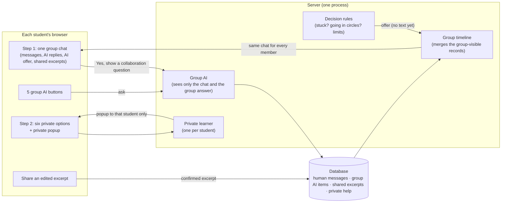

# How the final system works

This page explains, in plain language, how students meet the AI in the study and what the system records. It describes new groups created on the current settings (`policy-unified-1`). Groups that already exist keep the settings they started with.

## In one minute

- Each scenario still has three steps: **Step 1** group discussion, **Step 2** private AI help, **Step 3** the shared final answer.
- **Step 1 is one group chat.** Students' messages, the group AI's replies, the AI's occasional offer to help, and ideas that students choose to share from their private help all appear in this one chat, in time order, for every member.
- **Anyone can ask the group AI** with five buttons next to the message box. The reply appears in the chat for everyone and is labelled **AI Collaboration Assistant**, never as a student.
- **The AI speaks up by itself at most once per scenario**, and only when the group seems stuck or seems to be going in circles. Even then it only *offers*; nothing is written until a member says yes.
- **Step 2 is unchanged and private.** The six private help options, and the private popups, are only ever seen by the student they belong to. A student can share a short, edited excerpt with the group on purpose.
- **Step 3 is unchanged.**

## The picture



Private help never goes into the group timeline. The only way private text reaches the group is a student confirming an edited excerpt.

## Step 1: the group chat

### What students see

| In the chat | How it is labelled |
|---|---|
| A student's message | Their name, time and colour (as before) |
| A group AI reply | "AI Collaboration Assistant", the time, the kind of help, "Requested by Alex" or "Group suggestion", and a "Demo text (no AI service)" or "Template fallback" note when relevant |
| The AI's offer | "AI group suggestion available", with **Yes, show a collaboration question**, **Hide for me** and **Why this suggestion?** |
| A shared excerpt | "Shared by Alex · AI-assisted excerpt · from their private Small hint" |

A short note above the chat says that messages marked AI Collaboration Assistant come from the AI, that everyone sees them, and that the AI helps the group work together but does not give the answer. The discussion starter, the role suggestions and the discussion prompts ("What have we agreed on so far?" and so on) are unchanged.

While the AI is writing, a "Writing a collaboration question..." line appears in the chat and everyone can keep chatting. If the AI service fails, the line says "The AI is unavailable right now." and the group carries on.

If a student has scrolled up to read older messages, new messages do not pull them down. A "1 new message below" button appears instead and jumps to the newest message when clicked.

### The five group AI buttons

| Button | What the AI does |
|---|---|
| Summarize | Lists the main points so far and what is still open |
| Divide the thinking | Suggests how members could each look at a different part |
| Compare views | Helps the group compare different positions on one criterion |
| Guiding question | Asks one question that moves the reasoning forward |
| Check-in | A short "what have we agreed, what is next?" pause |

Limits:

- **6 group AI requests per scenario**, for the whole group. After that the message is "Your group has used all 6 group AI requests for this scenario".
- **30 seconds between requests from the same student.** A second click too early shows "You can ask the group AI again in N seconds", where N is the server's real remaining wait. Other members are not affected.
- A refused click is not stored, is not counted against the 6 and makes no AI call.
- Two members asking for the same kind of help at the same moment, or a double click, give one reply.

The group AI only sees the group chat and the shared group answer. It never sees private help, popups or anyone's Step 2 choices. Student text is treated as untrusted, so instructions typed into the chat cannot change what the AI is allowed to do.

### When the AI offers help by itself

The AI offers help only for two reasons:

1. **The group seems stuck:** nobody has written anything for 2 minutes after the scenario started, or there have been no new messages or answer edits for 3 minutes.
2. **The group seems to be going in circles:** members keep repeating the same positions without new reasons or evidence.

It stays silent when:

- the evidence is unclear;
- the disagreement looks productive (new reasons are still coming);
- a student is confused or asks how to organise the work (the buttons and Step 2 are there for that);
- one student writes much more than the others (no offers for participation imbalance).

It also stays silent while:

- fewer than two members are online;
- a group AI reply is being written;
- any member has clicked "I am good" on the final answer;
- the scenario is finished;
- a member asked the group AI by hand in the last 2 minutes;
- an earlier AI prompt's effect is still being observed.

**At most one offer per scenario.** An offer that nobody opens closes after 10 minutes. It still counts as the one offer for that scenario, but it is *not* treated as a "no" from the group.

The offer itself contains no AI text. If **any** member clicks **Yes, show a collaboration question**, the AI writes one reply and it appears in the same place for everyone. If two members click Yes at the same moment, there is still only one reply. **Hide for me** hides the offer only for the student who clicked it; the others can still open it. **Why this suggestion?** explains the reason in plain words, for example: "No new group activity for a while: there have been no new messages or answer edits for a few minutes…".

## Step 2: private help (unchanged)

- The six private options (Small hint, Guiding question, Brief explanation, Example, Feedback on your answer, Full expert answer) work exactly as before and are seen only by the student who chose them.
- **Private popups** still come from each student's own learner model. The popup is titled **"Private AI suggestion — only you can see this"** and offers **Yes, show me**, **Not now**, **No thanks**, **Why am I seeing this?** and **Don't suggest again in this scenario**. There are at most 2 per scenario, never in the first 45 seconds, and never a full answer.
- **Sharing on purpose:** under "Share a short idea with your group", a student:
  1. picks one of their private AI responses;
  2. edits the text (up to 600 characters);
  3. sees a preview ("Your group will see exactly this in the Step 1 chat…");
  4. clicks **Confirm and share**.

  Only that edited text appears in the group chat, marked as an AI-assisted excerpt. A Full expert answer cannot be shared this way.

## Step 3 (unchanged)

The shared answer box, "I am good", the 500-word limit, the colours and the submission rule all work as before.

## Examples

**(a) Asking the group AI.** Sam writes "I think option A is fairer". Alex writes "Option B is cheaper. Let's compare our reasons." Alex clicks **Summarize**. Both students see, below Alex's message: *AI Collaboration Assistant · Summary of the discussion · Requested by Alex*, followed by a short summary and an open question. Alex's buttons then pause for 30 seconds with a countdown ("You can ask the group AI again in 29 seconds"); Sam can still ask.

**(b) A stuck group.** Nobody writes for 3 minutes after Sam's first message. Both students see *AI group suggestion available: The AI has a collaboration question for your group (Check-in). Would you like to see it?* Sam clicks **Hide for me**, and Sam now sees only a small grey line. Alex clicks **Yes, show a collaboration question**, and the check-in question appears in the chat for both. No more offers come in this scenario.

**(c) Going in circles.** Alex repeats "A is fairer" three times and Sam repeats "B is cheaper", with no new reasons, for several minutes. The AI offers a "Compare views" question in the chat. If instead each message adds a new reason, the AI stays silent.

**(d) Private help and sharing.** Alex opens a Small hint in Step 2. Sam never sees it. Alex shares "Let's first agree what a good explanation must include." Both see *Shared by Alex · AI-assisted excerpt* with exactly that sentence and nothing else from the hint. Separately, Alex gets a private popup; Sam never sees it, and it never appears in the chat.

**(e) Problems.** If the AI service is down, the chat shows "The AI is unavailable right now." and the group continues. If the group has used all 6 requests, the buttons explain that. If a member is finalising the answer, no offer interrupts them.

## What researchers see

- **Exports are unchanged.** The chat export still contains only students' messages; AI replies are never mixed into it. The V2 and V2.3 exports keep their columns.
- The `/admin` group dashboard has an **"AI use (counted separately)"** panel listing each of these on its own:
  - human messages;
  - manual group AI requests and replies;
  - proactive offers made, accepted, replied to, expired, and closed by members;
  - private help calls in Step 2;
  - popups offered, accepted, declined, deferred and expired;
  - shared excerpts;
  - where the AI text came from (real AI, demo text or template);
  - "Did this help?" answers and outcomes, including unknown outcomes;
  - tokens;
  - failures.
- Each group keeps its own policy version. New home-page groups are `proactive_adaptive` on `policy-unified-1`. Groups on `policy-v2-2` or `policy-v2-3` keep their rules (for example how many offers they can get) but use the same chat layout. On `policy-v2-2`, where one member's dismissal used to close an offer for everyone, the chat shows **Not now** (personal) instead of **Hide for me**.

## For developers

- The group chat is built from one read model: `buildGroupTimeline` in `src/lib/groupTimeline.ts`. It is used both by the browser (from live state) and by `GET /api/sessions/[code]/timeline?scenarioOrder=N&participantId=…`, which needs the member's device token. Items have stable keys (`message:`, `intervention:`, `share:`, `checkpoint:` plus the row id) and kinds (`human_message`, `group_ai_message`, `group_ai_offer`, `shared_ai_excerpt`, `discussion_prompt`). Private items are filtered out.
- The decision rules are in `InterventionDecisionEngine.checkEligibility`. The two offer reasons come from `learningAware.groupOffers.proactiveTriggers` in `src/data/intervention-policies.json`, so older policies are not affected.
- A refused group request returns HTTP 429 with `code: "too_fast"`, `retryAfterSeconds` and a `Retry-After` header.
- No database tables were added or changed for this design.

## How to check it

```bash
npm test                 # unit + integration tests on a throwaway database
npm run build
npm run pilot:isolated   # real server + sockets on a throwaway database, two simulated students
npm run db:rehearse      # rehearse the schema push on a copy of data/research.db
npm run db:verify        # read-only integrity check
```

The test-only policy `policy-unified-1-test-accelerated` uses seconds instead of minutes so that the pilot can see an offer quickly. It needs `ADAPTIVE_V2_ALLOW_TEST_POLICY=true` and is never used for research.
